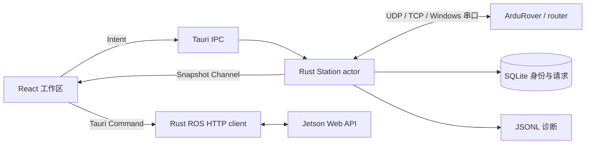

# 架构

## 进程与状态

Tauri 启动独立的 `usv-control` Rust 线程。该线程持有所有套接字、MAVLink 解码器、发送队列、请求记录、任务协议和安全状态。它每 10 ms 驱动网络与期限，每 100 ms 发布一次不可变快照。

React 通过 Tauri Command 提交 `Intent`，通过 Channel 订阅快照。切换页面、重建地图或卸载组件只改变订阅和展示，不创建连接或命令定时器。

## 代码职责

| 模块 | 职责 |
|---|---|
| `wire` | rust-mavlink 标准消息、原始 u16 command 扩展、CRC、TCP 流解码 |
| `transport` | 非阻塞 TCP/UDP，Windows 串口 |
| `telemetry` | ArduRover 识别、独立心跳/载荷遥测接收时间、字段与轨迹 |
| `identity` | SQLite FULL 同步、事务 session 分配、请求与保护状态 |
| `payload` | 请求生命周期、重传条件、USVE1、STATUSTEXT 重组 |
| `mission` | home 占位、42702、任务收发、重试和回读比较 |
| `station` | 意图准入、队列、重连、停止范围、状态收敛 |
| `ros` / `maps` | Web 配置/数据、原字节下载、瓦片缓存 |
| `diagnostics` | 时钟域、JSONL 轮转及 ZIP |
| `src-tauri` | IPC、应用目录、Channel 与文件保存 |

HTTP 请求在 Tauri blocking pool 中运行，不占用 MAVLink actor。地图和归档请求失败不会重置控制连接。

## 持久化与恢复

连接参数与目标 sysid 使用现有 SQLite metadata 保存。Rust 引擎初始化时读取配置，将连接交给原有网络线程建立及重试；React 只从快照恢复表单。手动断开清除当前连接意图，保留保存项供下次进程启动。连接配置读写错误单独显示，不改变请求身份和停止保护。

每次应用运行获得新 session。请求在进入发送队列前保存。重启加载所有未退休记录及最近 2000 条历史，按时间排列；历史任务所属 generation 与新连接隔离。未确认的物理任务恢复为 unknown，关闭重试。

接单、终态和停止依据保存在原请求上。新的请求只能由新的操作意图创建。恢复依赖 ROS bridge 的原 executor 查询及后续真实事件；地面站没有用于恢复的 START 重发入口。

## 队列与失败

停止消息排在尚未发送的普通消息之前。TCP 已经开始的半帧先完成，超过一秒则退役连接，避免截断后拼出损坏的 MAVLink 流。连接丢失清空队列并禁用旧请求重试。

推进上锁由发送后新心跳确认，载荷停止由关联事件确认，两者分别保留证据。载荷结束还需新静止遥测收敛，失败清理和未知输出继续保留保护。

## 数据和资源

通信日志最多保留四个约 10 MiB JSONL 文件；UI 内存记录最多 2000 条，快照显示最近 160 条。轨迹最多 10000 点，曲线最多 1200 点。ROS 地图缓存按服务 origin 的 SHA256、style、z/x/y 分目录；Google 按独立 provider、style、z/x/y 保存 PNG/JPEG。Google 旧缓存立即返回，后台去重刷新；下载失败保留旧文件。定位、预缓存和 HTTP 工作与控制线程分离。

未实现通用插件、消息总线、多机控制、完整参数编辑或固件升级。
